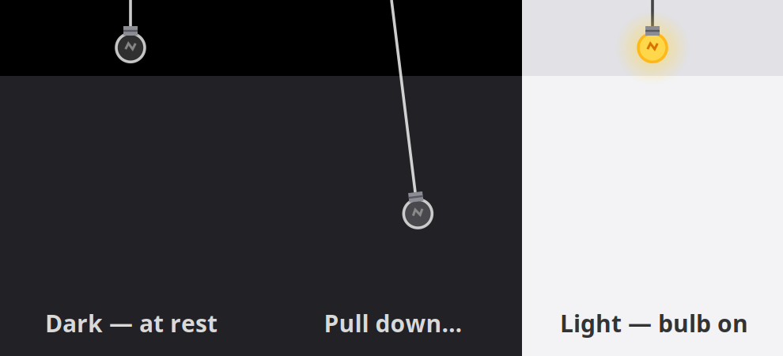

# Bulb Theme Toggle

A GNOME Shell extension that hangs a little light bulb from your top bar.
**Pull it down** to switch between dark and light theme.



- The cord stretches as you drag, and stiffens the further you pull. Drag sideways and the bulb swings.
- Let go after a firm pull (about 36px) and the theme flips, then the bulb bounces back up. A short pull springs back without changing anything.
- A plain click also toggles the theme.
- The bulb is lit in light mode and dark in dark mode. It stays in sync if you change the theme somewhere else, such as Settings.

## What it changes

- `org.gnome.desktop.interface color-scheme`: `prefer-dark` ↔ `default`
- `org.gnome.desktop.interface gtk-theme`: switches to the matching light/dark variant if one is installed,
  e.g. `Mojave-dark-solid` ↔ `Mojave-light-solid`, `Yaru-blue-dark` ↔ `Yaru-blue`, `Adwaita-dark` ↔ `Adwaita`.

## Install

Tested on GNOME Shell 46 (Ubuntu 24.04).

```sh
git clone https://github.com/iam-shanmukha/gnome-bulb-theme-toggle.git
cd gnome-bulb-theme-toggle
make install
```

On Wayland, log out and back in, then enable it:

```sh
gnome-extensions enable bulb-theme-toggle@iam-shanmukha.github.io
```

## Tweaking

The pull distance, swing, and spring timing are constants at the top of `extension.js`.
The bulb's size and shape are in `bulb.js`.

## License

GPL-2.0-or-later
